# PBLogfileViewer – Hilfe

## 1. Einführung
PBLogfileViewer ist eine Desktop-Anwendung zur Anzeige und Auswertung von PowerBox-Telemetrie-Logdateien.

Die Anwendung ermöglicht es, aufgezeichnete Telemetriedaten übersichtlich darzustellen und deren zeitlichen Verlauf 
anhand grafischer Darstellungen zu analysieren.

PBLogfileViewer wird als eigenständiges Projekt entwickelt und ist kein offizielles Produkt von PowerBox Systems.

## 2. Installation und Programmstart
### 2.1 Windows

PBLogfileViewer wird unter Windows über ein Windows-Installationspaket (MSI) installiert.

Der Installationsordner kann während der Installation frei gewählt werden. Es wird empfohlen, 
die Anwendung in der üblichen Windows-Programmordnerstruktur zu installieren.

1. Die MSI-Installationsdatei herunterladen.
2. Die heruntergeladene Datei per Doppelklick starten.
3. Den Anweisungen des Installationsprogramms folgen.
4. Nach Abschluss der Installation kann PBLogfileViewer über das Startmenü oder das Desktop-Symbol gestartet werden.

### 2.2 Linux und macOS

Unterstützung für Linux und macOS ist für zukünftige Versionen vorgesehen.

## 3. Arbeiten mit PBLogfileViewer

### 3.1 Logdateien auswählen
Nach dem Start von PBLogfileViewer öffnet sich automatisch der Dateiauswahldialog.

Der Dateiauswahldialog verfügt über eine spezielle Navigationsoberfläche:

- Im oberen Bereich befindet sich eine Breadcrumb-Leiste, die den aktuellen Verzeichnispfad anzeigt.
- Darunter werden die Unterordner des jeweils ausgewählten Verzeichnisses vertikal aufgelistet.
- Mit einem einfachen Mausklick kann ein Ordner ausgewählt und die Navigation fortgesetzt werden.

Sobald in einem Verzeichnis LOG-Dateien (`*.log`) erkannt werden, wird dieses Verzeichnis blau hervorgehoben.

Beim Öffnen des Verzeichnisses werden alle darin enthaltenen LOG-Dateien sowie eine eventuell vorhandene GPX-Datei angezeigt. 

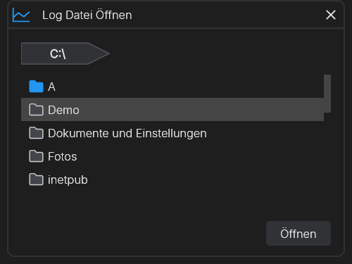

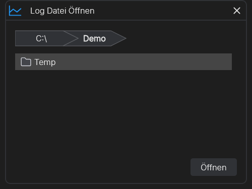

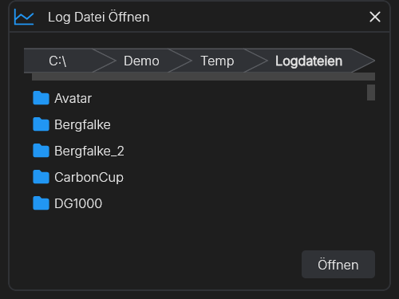

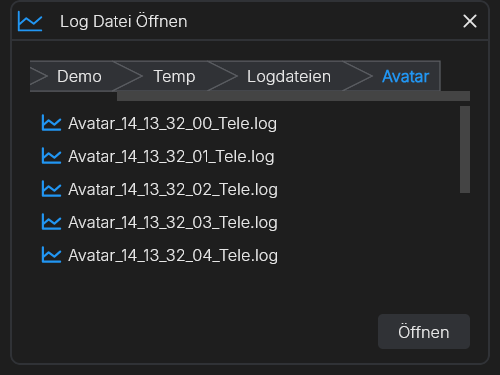

**LOG-Datei auswählen**

Es muss lediglich eine einzige LOG-Datei ausgewählt werden. Dabei ist es unerheblich, welche Datei eines Fluges ausgewählt wird. Besteht ein Flug aus mehreren LOG-Dateien, erkennt PBLogfileViewer automatisch die zusammengehörigen Dateien und berücksichtigt diese bei der weiteren Verarbeitung.

Eine eventuell vorhandene GPX-Datei wird ebenfalls angezeigt. Sie dient in diesem Dialog ausschließlich der Information und kann nicht ausgewählt werden. Falls noch keine GPX-Datei vorhanden ist, kann diese zu einem späteren Zeitpunkt durch PBLogfileViewer erzeugt werden.

Sobald eine LOG-Datei ausgewählt wurde, wird die Schaltfläche **Öffnen** aktiviert.

Mit einem Klick auf **Öffnen** wird der Dateiauswahldialog geschlossen. Unmittelbar danach öffnet sich der Dialog zur Auswahl der Messwerte.

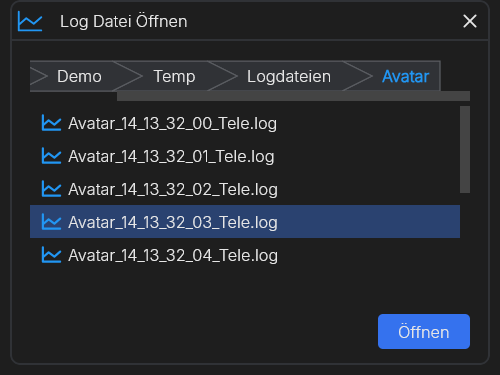

### 3.2 Messwerte auswählen

Nach dem Öffnen der LOG-Datei erscheint der Dateiauswahldialog zur Auswahl der Messwerte.

Die verfügbaren Messwerte werden in einer hierarchischen Baumstruktur dargestellt.

An oberster Stelle befindet sich der Modellname. Darunter sind die einzelnen im Modell vorhandenen Geräte aufgeführt, beispielsweise:

- Empfänger
- Stromversorgungen
- Vario

Unterhalb der jeweiligen Geräte befinden sich die zugehörigen Messkanäle. Beim Vario sind dies beispielsweise Steigrate, Höhe und Temperatur.

Auf derselben Hierarchieebene wie das Modell befindet sich der Sender. Darunter werden dessen Messkanäle angezeigt, beispielsweise Batteriespannungen und die Qualität der Funkverbindung.

Hinweis: die Baumansicht kann mit der Taste **X** auf/zugeklappt werden, sowie durch Mausklick auf die kleinen 
Pfeile links neben dem Modellnamen.

**Messkanäle auswählen**

Die Auswahl der Messkanäle erfolgt durch Anklicken mit der Maus.

Es können mehrere Messkanäle gleichzeitig ausgewählt werden:

- **[ALT] + Mausklick:** Mehrfachauswahl einzelner Messkanäle.
- **[CTRL] + [A]:** Auswahl von bis zu sechs Messkanälen.

Es können maximal sechs Messkanäle gleichzeitig ausgewählt werden.

**Messdaten laden**

Für das Laden der Messdaten stehen zwei Schaltflächen zur Verfügung:

- **Reduziert:** Es werden deutlich weniger Messwerte geladen. Dadurch wird eine möglichst hohe Ladegeschwindigkeit erreicht.
- **Vollständig:** Es werden sämtliche verfügbaren Messwerte geladen.
  Nach dem Klick auf **Reduziert** oder **Vollständig** werden die Messdaten geladen und anschließend unmittelbar in der grafischen Auswertung dargestellt. 

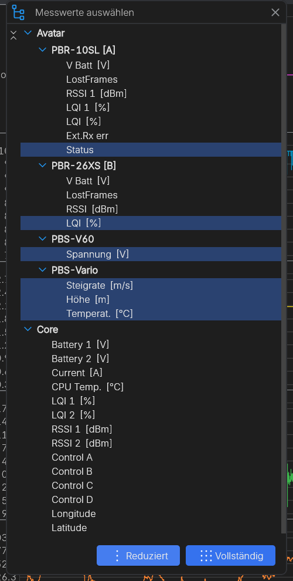

### 3.3 Die grafische Auswertung

Nach dem Laden der Messdaten öffnet sich das Hauptfenster mit der grafischen Auswertung.

**Titelleiste**

Die Titelleiste enthält folgende Informationen und Bedienelemente:

- Anwendungsicon und Programmname
- Hamburger-Schaltfläche zum Öffnen des Hauptmenüs
- Optional ein GPX-Dateisymbol, wenn eine GPX-Datei vorhanden ist
- Modellname
- Datum und Uhrzeit der Aufzeichnung
- Aufzeichnungsdauer
- Art der geladenen Daten (Reduziert oder Vollständig)
- Gegebenenfalls die Zoomstufe in Prozent
- Gegebenenfalls eine zusätzliche Zeitspannenangabe
- Gegebenenfalls ein Mondsymbol, wenn die Aufzeichnung über Mitternacht hinausgeht und somit zwei Kalendertage umfasst

**Diagrammbereich**

Unterhalb der Titelleiste werden maximal sechs Liniendiagramme untereinander dargestellt.

Die einzelnen Diagramme unterscheiden sich farblich . Als Diagrammtitel wird jeweils der Name des Messkanals angezeigt, gegebenenfalls ergänzt um die Einheit oder das Einheitenzeichen.

Auf der linken Seite jedes Diagramms befindet sich die Y-Achse. Deren Beschriftung richtet sich nach dem jeweiligen Messkanal und kann unterschiedliche Darstellungsformen enthalten:

- Ganzzahlige Werte
- Dezimalwerte
- Textwerte (Status)
- Himmelsrichtungen

  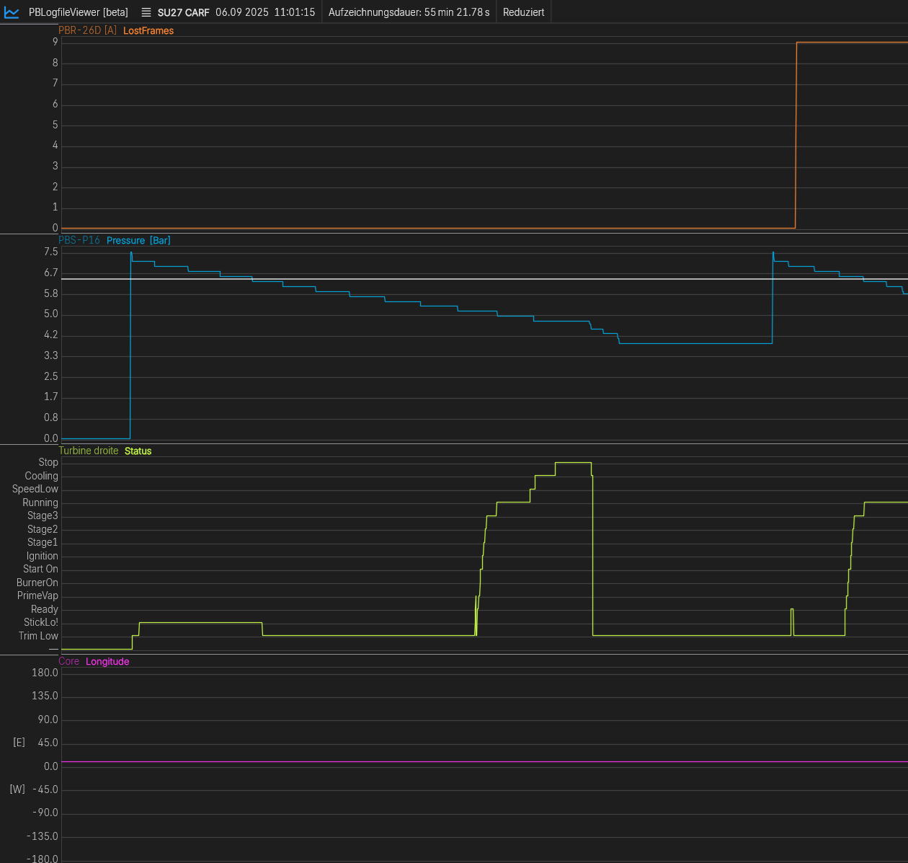

**Fadenkreuz und Messwertanzeige**

Das Fadenkreuz ist direkt an die Mausbewegung gekoppelt und markiert die aktuelle Position innerhalb der Diagramme.

Die Messwertanzeige wird abhängig von der Mausposition stets in der Nähe des Schnittpunkts des Fadenkreuzes eingeblendet.

Sie zeigt die Messwerte an, die sich an der jeweiligen Pixelposition innerhalb der Diagramme befinden.

Die Messwertanzeige ist folgendermaßen aufgebaut:

- Im oberen Bereich wird, leicht nach rechts eingerückt, der Zeitstempel des aktuell angezeigten Messwertes dargestellt.
- Darunter steht linksbündig der Name des jeweiligen Gerätes.
- Anschließend werden die zugehörigen Messwerte aufgelistet. Jeder Eintrag besteht aus:
  - einem Farbbalken am linken Rand, dessen Farbe der Linienfarbe des zugehörigen Diagramms entspricht,
  - dem Namen des Messkanals,
  - dem aktuellen Messwert,
  - gegebenenfalls der zugehörigen Einheit oder dem Einheitenzeichen.

Messwerte desselben Gerätes werden gruppiert dargestellt.

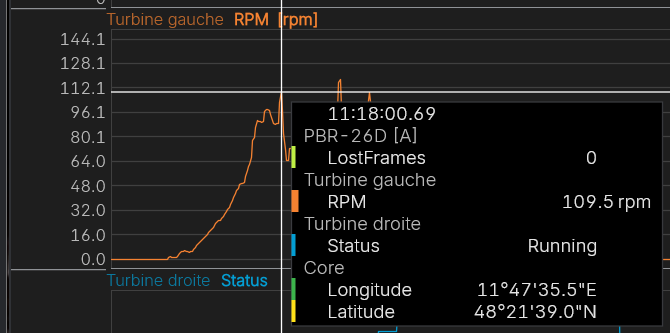

Je nach Einstellung können zu jedem Messwert zusätzliche Statusinformationen angezeigt werden:

- **Messwertstatus:** Kennzeichnet fehlende oder nicht verfügbare Messwerte:
  - **MF (Missing Frame):** Fehlender Datenframe.
  - **NV (No Value):** Für diesen Zeitpunkt liegt kein Messwert vor.
  - **ND (No Data):** Es sind keine Daten verfügbar.
- **Alter des letzten gültigen Messwertes:** Gibt an, wie lange der zuletzt gültige Messwert bereits zurückliegt.

#### Kontextmenü der Diagramme

Durch einen Rechtsklick auf ein Diagramm wird eine schwebende Menüleiste eingeblendet.
Sie enthält folgende Funktionen in dieser Reihenfolge: 

- **Messdatenanzeige:** Umschaltung zwischen reduzierter und vollständiger Anzeige der Messdaten.
- **Dateiauswahldialog:** Öffnet erneut den Dateiauswahldialog.
- **Zeitmessung:** Ermöglicht die Messung des Zeitabstands zwischen zwei Ereignissen.
- **Konfiguration:** Öffnet den Konfigurationsdialog.

  

#### Zeitmessung

Nach dem Aktivieren der Zeitmessung wird Menüleiste ausgeblendet. Auch die Messwertanzeige verschwindet.

Während der Zeitmessung wird lediglich eine vertikale gestrichelte Linie an der aktuellen Mausposition angezeigt.

**Ereignisse markieren**

Die beiden Ereignisse werden nacheinander direkt im Diagramm durch Mausklick markiert. Beispielsweise kann so der Zeitpunkt des Motorstarts und der Zeitpunkt der erreichten Flughöhe ermittelt werden.

Wird die vertikale Linie nahe genug an den linken oder rechten Rand des Anwendungsfensters bewegt, erscheint ein Pfeilsymbol. Dieses signalisiert, dass bei einem Mausklick automatisch der erste bzw. letzte verfügbare Messwert für die Zeitmessung ausgewählt wird.

Links wird somit der erste, rechts der letzte Messwert der Aufzeichnung verwendet.

**Zeitspanne anzeigen**

Nach der Markierung beider Ereignisse wird die gemessene Zeitspanne auf zwei Arten dargestellt:

- Im Diagrammbereich durch zwei pinkfarbene vertikale gestrichelte Linien, welche die markierten Zeitpunkte kennzeichnen.
- In der Statusleiste durch ein entsprechendes Symbol und die Angabe der gemessenen Zeitspanne.
  **Zeitmessung beenden**

Die Zeitmessung kann auf drei Arten beendet werden:

- Durch einen Mausklick im Diagrammbereich
- Durch eine Zoom-Aktion
- Durch Drücken der **ESC-Taste**

Anschließend wird die normale Diagrammansicht wiederhergestellt.

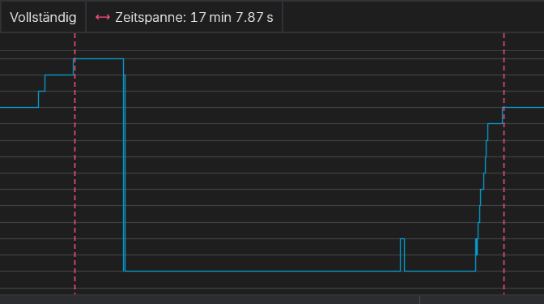

#### Konfiguration

Über den Konfigurationsdialog kann die Darstellung der Diagramme und Messwerte angepasst werden.

Für jeden Messwert können unabhängig voneinander folgende Einstellungen vorgenommen werden:

- **Bezeichnung:** Der angezeigte Text des Messwertes kann geändert werden. Beispielsweise kann „Längengr.“ durch „Längengrad“ ersetzt werden.
- **Einheit:** Die angezeigte Einheit oder das Einheitenzeichen kann angepasst werden.
- **Umrechnungsfaktor:** Der Messwert kann mit einem frei festlegbaren Faktor umgerechnet werden.

Ein Beispiel ist die Drehzahl eines Elektromotors: Wird diese in den LOG-Daten mit dem Faktor 10 gespeichert, kann der Anwender einen entsprechenden Umrechnungsfaktor festlegen und als Einheit beispielsweise U/min eintragen.

Nach Übernahme der Konfiguration wird der betreffende Messwert durch ein Stiftsymbol gekennzeichnet. Dadurch ist erkennbar, dass seine Darstellung angepasst wurde.

**Hinweis:** Die Festlegung der Bezeichnungen, Einheiten und Umrechnungsfaktoren erfolgt ausschließlich durch den Anwender. Dieser ist selbst dafür verantwortlich, dass die gewählten Einstellungen den tatsächlichen Messdaten und deren Bedeutung entsprechen.

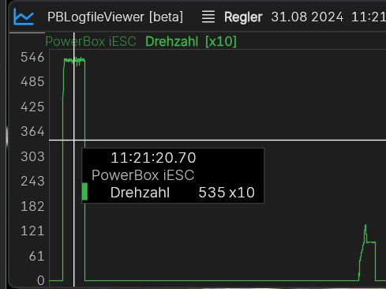

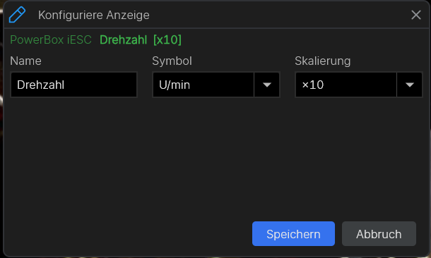

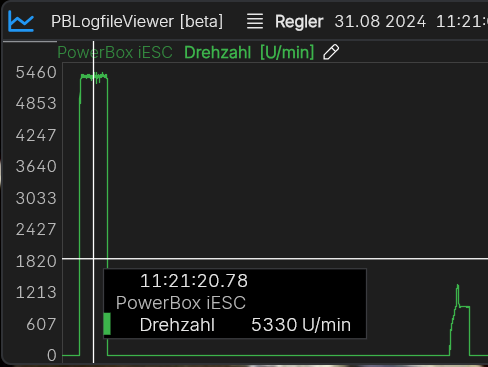

Die Konfiguration wird nach Beenden des Dialogs gespeichert un steht nach einen Programmneustart wieder zur Verfügung.

#### Zoomen

Die Vergrößerung bzw. Verkleinerung des dargestellten Zeitbereichs erfolgt ausschließlich über das Mausrad.
Klickt man das Mausrad wird der Zoomfaktor auf 100 Prozent zurückgesetzt.

Der Zoomvorgang bezieht sich immer exakt auf die aktuelle Mausposition. Diese bleibt beim Zoomen der Bezugspunkt.

Wird das Fadenkreuz nahe genug an den linken oder rechten Rand des Anwendungsfensters bewegt, erscheint ein Pfeilsymbol. Dieses signalisiert, dass der Zoomvorgang auf den Anfang bzw. das Ende der Aufzeichnung bezogen wird:

- **Linker Rand:** Der erste verfügbare Messwert ist der Bezugspunkt.
- **Rechter Rand:** Der letzte verfügbare Messwert ist der Bezugspunkt.

## 4. Menüleiste

Die Menüleiste wird über das Hamburger-Symbol in der Titelleiste geöffnet. Sie enthält die drei Menüs **Datei**, **Ansicht** und **Hilfe**.

### 4.1 Datei

Das Menü **Datei** enthält folgende Funktionen:

- **Dateidialog:** Öffnet erneut den Dateiauswahldialog. Der angezeigte Tastatur-Shortcut ist **F**.
- **Messwerte:** Öffnet den Dialog zur Auswahl der Messwerte. Der angezeigte Tastatur-Shortcut ist **S**.
- **GPX-Datei erzeugen:** Öffnet den Dialog zum Erzeugen einer GPX-Datei.
- **Einstellungen:** Öffnet den Dialog mit den Anwendungseinstellungen.
- **Beenden:** Beendet PBLogfileViewer.

### 4.2 Ansicht

Das Menü **Ansicht** ermöglicht den Wechsel zwischen den beiden Ansichten im Inhaltsbereich der Anwendung:

- **Statistik:** Öffnet die Statistikansicht.
- **Diagramme:** Öffnet die grafische Darstellung der Messwerte.

Die Statistik wird bereits beim Öffnen einer LOG-Datei im Hintergrund erstellt und steht anschließend in der Statistikansicht zur Verfügung.

### 4.3 Hilfe

Das Menü **Hilfe** enthält folgende Funktion:

- **Über... :** Öffnet den Dialog mit Lizenzhinweisen sowie weiteren Informationen über PBLogfileViewer.

## 5. GPX-Datei erzeugen

Über **Datei → GPX-Datei erzeugen** kann aus den vorhandenen Telemetriedaten eine GPX-Datei erstellt werden.

Dazu öffnet sich ein Dialog zur Auswahl der Messwerte. Die Bedienung entspricht dem bereits beschriebenen Dialog zur Auswahl der Messwerte (siehe Abschnitt 3.2). Allerdings werden hier nur Messwerte angeboten, die für die Erzeugung einer GPX-Datei relevant sein können.

**Hinweis:** Der Anwender ist selbst dafür verantwortlich, geeignete Messwerte auszuwählen. Die Anwendung prüft nicht, ob die gewählten Messwerte für eine sinnvolle GPX-Datei geeignet sind, entfernt aber nicht plausible Messwerte aus der Ansicht.

Die erzeugte GPX-Datei wird im selben Ordner gespeichert wie die zugehörigen LOG-Dateien.

## 6. Einstellungen

Der Einstellungsdialog enthält verschiedene Konfigurationsmöglichkeiten. Im Folgenden werden nur die Optionen zum Datenstatus erläutert. Die übrigen Einstellungen sind selbsterklärend.

### 6.1 Datenstatus

Für die Messwertanzeige stehen zwei Optionen zur Verfügung:

- **Status anzeigen:** Aktiviert die Anzeige der Messwertstatus **MF (Missing Frame)**, **NV (No Value)** oder **ND (No Data)**.
- **Alter des letzten gültigen Messwertes:** Aktiviert zusätzlich die Anzeige, wie lange der zuletzt gültige 
  Messwert bereits zurückliegt (z.B. 2,5 s).

Die zweite Option kann nur aktiviert werden, wenn **Status anzeigen** eingeschaltet ist. Wird die Statusanzeige deaktiviert, wird automatisch auch die Anzeige des Alters deaktiviert.

## 7. Lizenzen und Hinweise

PBLogfileViewer verwendet verschiedene Softwarekomponenten und Ressourcen von Drittanbietern, die eigenen Lizenzbedingungen unterliegen.

Eine Übersicht der verwendeten Drittanbieter-Komponenten sowie die zugehörigen Lizenztexte und Hinweise befinden sich in der Datei [`THIRD-PARTY-LICENSES.md`](../THIRD-PARTY-LICENSES.md) und im Verzeichnis `licenses`.

