# PBLogfileViewer – User Guide

## 1. Introduction

PBLogfileViewer is a desktop application for viewing and analysing PowerBox telemetry log files.

The application allows recorded telemetry data to be displayed clearly and its progression over time to be analysed using graphical representations.

PBLogfileViewer is developed as an independent project and is not an official product of PowerBox Systems.

## 2. Installation and Startup

### 2.1 Windows

PBLogfileViewer is installed on Windows using a Windows Installer package (MSI).

The installation directory can be selected freely during installation. It is recommended that the application be installed in the standard Windows Program Files directory structure.

1. Download the MSI installation file.
2. Double-click the downloaded file to start the installer.
3. Follow the instructions provided by the installer.
4. Once installation is complete, PBLogfileViewer can be started from the Start menu or using the desktop icon.

### 2.2 Linux and macOS

Support for Linux and macOS is planned for future versions.

## 3. Working with PBLogfileViewer

### 3.1 Selecting Log Files

When PBLogfileViewer starts, the file selection dialog opens automatically.

The file selection dialog features a dedicated navigation interface:

- A breadcrumb bar at the top displays the current directory path.
- Below it, the subfolders of the currently selected directory are listed vertically.
- A single mouse click selects a folder and allows navigation to continue.

As soon as LOG files (`*.log`) are detected in a directory, that directory is highlighted in blue.

When the directory is opened, all LOG files it contains, together with any GPX file that may be present, are displayed.

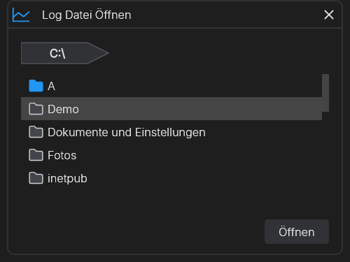

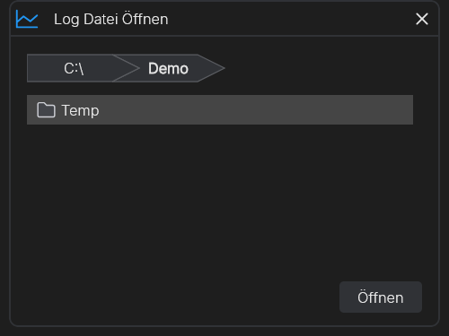

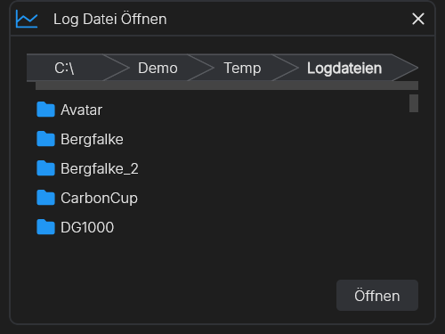

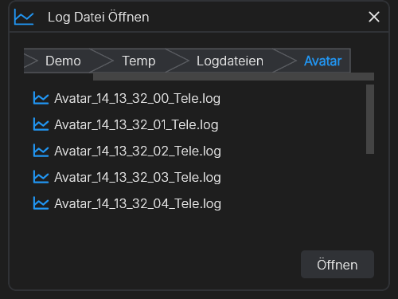

**Selecting a LOG File**

Only one LOG file needs to be selected. It does not matter which file belonging to a particular flight is chosen. If a flight consists of several LOG files, PBLogfileViewer automatically identifies the files belonging together and takes them into account during subsequent processing.

Any GPX file that may be present is also displayed. In this dialog, it is for information purposes only and cannot be selected. If no GPX file exists yet, one can be generated later using PBLogfileViewer.

Once a LOG file has been selected, the **Open** button becomes enabled.

Clicking **Open** closes the file selection dialog. The measurement selection dialog then opens immediately.

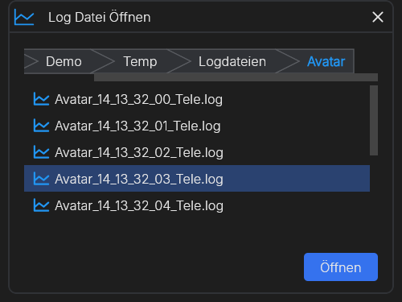

### 3.2 Selecting Measurements

After opening the LOG file, the measurement selection dialog appears.

The available measurements are displayed in a hierarchical tree structure.

At the top level is the model name. Below it are the individual devices installed in the model, for example:

- Receiver
- Power supplies
- Vario

The corresponding measurement channels are listed beneath each device. For the Vario, these include, for example, climb rate, altitude and temperature.

The transmitter is located at the same hierarchical level as the model. Its measurement channels are listed below it, for example battery voltages and radio link quality.

**Note:** The tree view can be expanded or collapsed using the **X** key or by clicking the small arrows to the left of the model name.

**Selecting Measurement Channels**

Measurement channels are selected by clicking them with the mouse.

Several measurement channels can be selected simultaneously:

- **[ALT] + mouse click:** Selects multiple individual measurement channels.
- **[CTRL] + [A]:** Selects up to six measurement channels.

A maximum of six measurement channels can be selected simultaneously.

**Loading Measurement Data**

Two buttons are available for loading the measurement data:

- **Reduced:** Loads significantly fewer measurement values to achieve the fastest possible loading time.
- **Complete:** Loads all available measurement values.

After clicking **Reduced** or **Complete**, the measurement data is loaded and immediately displayed in the graphical view.

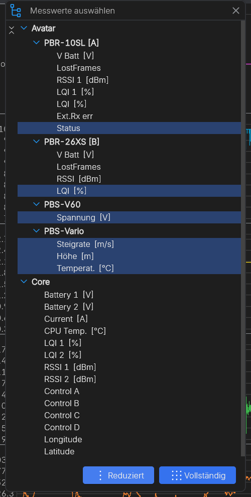

### 3.3 Graphical View

Once the measurement data has been loaded, the main window opens, displaying the graphical view.

**Title Bar**

The title bar contains the following information and controls:

- Application icon and programme name
- Hamburger button to open the main menu
- Optional GPX file icon, if a GPX file is available
- Model name
- Recording date and time
- Recording duration
- Type of data loaded (Reduced or Complete)
- Zoom level in per cent, if applicable
- Additional time span information, if applicable
- A moon icon, if the recording extends beyond midnight and therefore covers two calendar days

**Chart Area**

Up to six line charts are displayed vertically beneath the title bar.

The individual charts are distinguished by colour. Each chart title shows the name of the measurement channel, optionally supplemented by its unit or unit symbol.

The Y-axis is located on the left-hand side of each chart. Its labels depend on the respective measurement channel and may use different formats:

- Integer values
- Decimal values
- Text values (status)
- Compass directions

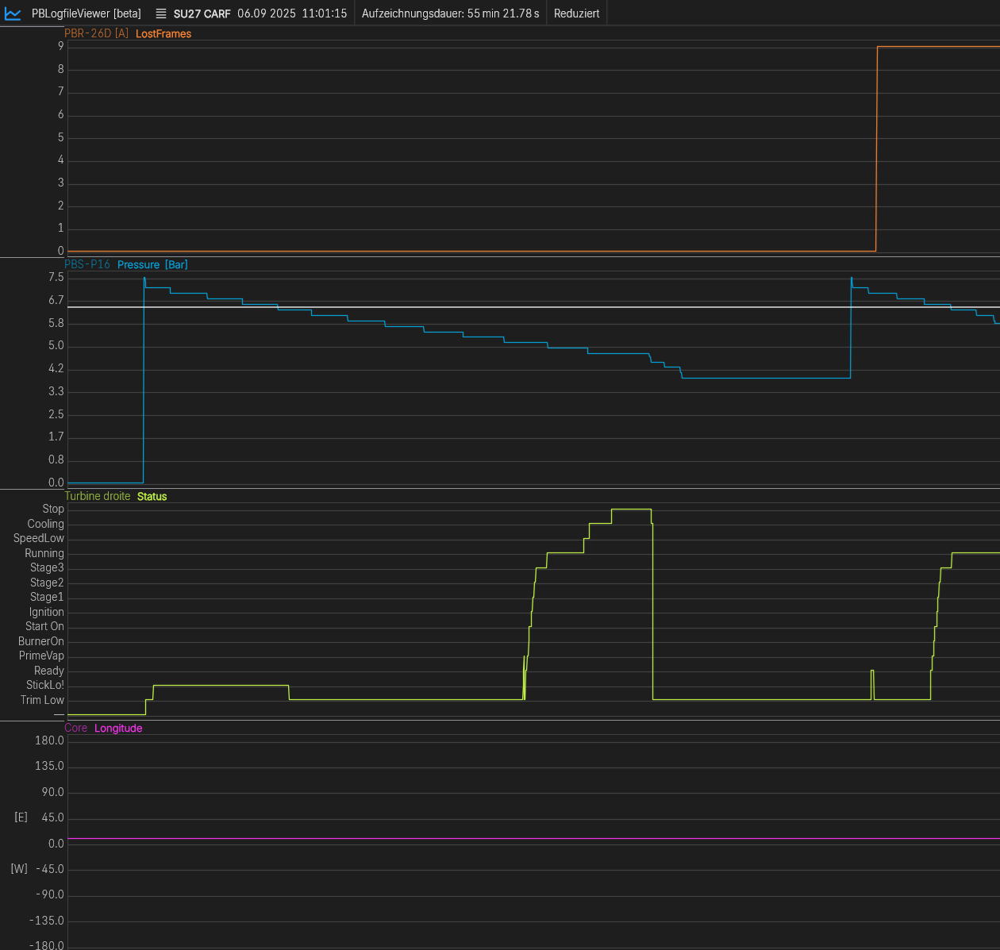

**Crosshair and Measurement Display**

The crosshair follows the mouse movement and marks the current position within the charts.

The measurement display is always shown close to the intersection of the crosshair, depending on the current mouse position.

It displays the measurement values located at the corresponding pixel position within the charts.

The measurement display is structured as follows:

- At the top, slightly indented to the right, the timestamp of the currently displayed measurement is shown.
- Below it, the name of the corresponding device is displayed, aligned to the left.
- The associated measurements are then listed. Each entry consists of:
  - A coloured bar on the left, matching the line colour of the corresponding chart.
  - The name of the measurement channel.
  - The current measurement value.
  - The corresponding unit or unit symbol, if applicable.

Measurements belonging to the same device are grouped together.

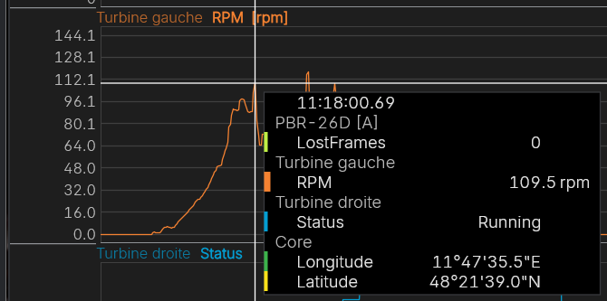

Depending on the settings, additional status information can be displayed for each measurement:

- **Measurement Status:** Indicates missing or unavailable measurements:
  - **MF (Missing Frame):** A data frame is missing.
  - **NV (No Value):** No measurement value is available at this point in time.
  - **ND (No Data):** No data is available.
- **Age of the Last Valid Measurement:** Indicates how long ago the last valid measurement was recorded.

#### Chart Context Menu

Right-clicking a chart opens a floating menu bar.

It contains the following functions in this order:

- **Measurement Data Display:** Switches between reduced and complete display of the measurement data.
- **File Selection Dialog:** Reopens the file selection dialog.
- **Time Measurement:** Allows the time interval between two events to be measured.
- **Configuration:** Opens the configuration dialog.

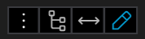

#### Time Measurement

Once time measurement has been activated, the menu bar disappears. The measurement display also disappears.

During time measurement, only a vertical dashed line at the current mouse position is displayed.

**Marking Events**

The two events are marked one after the other directly in the chart by clicking with the mouse. For example, this can be used to determine the time of motor start and the time at which a particular flight altitude was reached.

If the vertical line is moved sufficiently close to the left or right edge of the application window, an arrow symbol appears. This indicates that clicking the mouse will automatically select the first or last available measurement for time measurement.

The first measurement of the recording is therefore used on the left, and the last measurement on the right.

**Displaying the Time Interval**

Once both events have been marked, the measured time interval is displayed in two ways:

- In the chart area, by two pink vertical dashed lines indicating the marked points in time.
- In the status bar, by a corresponding icon and the measured time interval.

**Ending Time Measurement**

Time measurement can be ended in three ways:

- By clicking in the chart area.
- By performing a zoom operation.
- By pressing the **ESC** key.

The normal chart view is then restored.

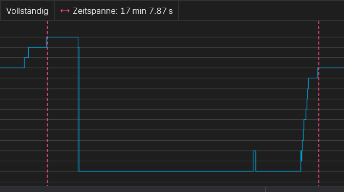

#### Configuration

The configuration dialog allows the display of charts and measurements to be customised.

The following settings can be adjusted independently for each measurement:

- **Label:** The displayed measurement text can be changed. For example, "Longitude" can be used instead of an abbreviated label.
- **Unit:** The displayed unit or unit symbol can be customised.
- **Conversion Factor:** The measurement value can be converted using a freely configurable factor.

For example, consider the rotational speed of an electric motor: if the value is stored in the LOG data multiplied by a factor of 10, the user can specify the appropriate conversion factor and enter a unit such as rpm.

Once the configuration has been applied, the corresponding measurement is marked with a pencil icon. This indicates that its display has been customised.

**Note:** The user is solely responsible for defining the labels, units and conversion factors, and for ensuring that the chosen settings correctly reflect the actual measurement data and its meaning.

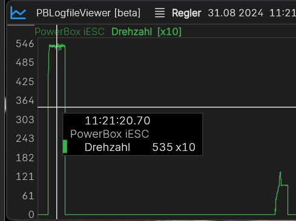

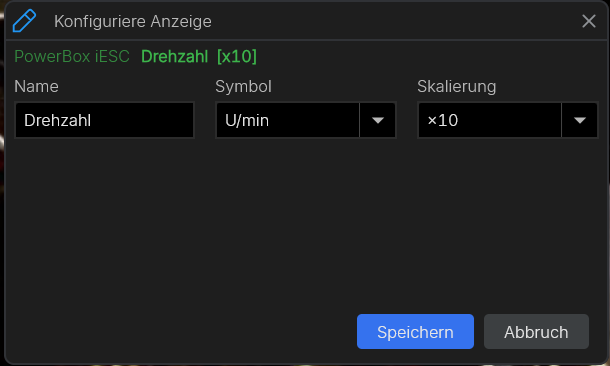

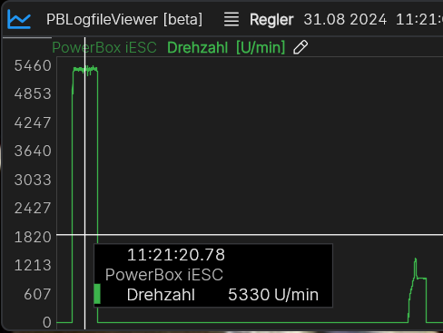

The configuration is saved when the dialog is closed and remains available after restarting the application.

#### Zooming

The displayed time range can be enlarged or reduced using the mouse wheel only.
Clicking the mouse wheel resets the display to 100 per cent.

Zooming is always centred precisely on the current mouse position, which remains the reference point during the zoom operation.

If the crosshair is moved sufficiently close to the left or right edge of the application window, an arrow symbol appears. This indicates that the zoom operation will use the beginning or end of the recording as its reference point:

- **Left edge:** The first available measurement is used as the reference point.
- **Right edge:** The last available measurement is used as the reference point.

## 4. Menu Bar

The menu bar is opened using the hamburger button in the title bar. It contains three menus: **File**, **View** and **Help**.

### 4.1 File

The **File** menu contains the following functions:

- **File Selection:** Reopens the file selection dialog. The displayed keyboard shortcut is **F**.
- **Measurements:** Opens the measurement selection dialog. The displayed keyboard shortcut is **S**.
- **Create GPX File:** Opens the dialog for creating a GPX file.
- **Settings:** Opens the application settings dialog.
- **Exit:** Closes PBLogfileViewer.

### 4.2 View

The **View** menu allows you to switch between the two views in the application's content area:

- **Statistics:** Opens the statistics view.
- **Charts:** Opens the graphical representation of the measurements.

The statistics are generated in the background as soon as a LOG file is opened and are then available in the statistics view.

### 4.3 Help

The **Help** menu contains the following function:

- **About...:** Opens a dialog containing licence information and further details about PBLogfileViewer.

## 5. Creating a GPX File

A GPX file can be created from the available telemetry data via **File → Create GPX File**.

A measurement selection dialog opens. Its operation is the same as that of the measurement selection dialog described in Section 3.2. However, only measurements that may be relevant for creating a GPX file are offered here.

**Note:** The user is solely responsible for selecting suitable measurements. The application does not check whether the selected measurements are suitable for creating a meaningful GPX file. However, implausible measurement values are excluded from the display.

The generated GPX file is saved in the same folder as the associated LOG files.

## 6. Settings

The settings dialog provides various configuration options. Only the options relating to data status are described below. The remaining settings are self-explanatory.

### 6.1 Data Status

Two options are available for the measurement display:

- **Show Status:** Enables the display of measurement status indicators **MF (Missing Frame)**, **NV (No Value)** and **ND (No Data)**.
- **Age of Last Valid Measurement:** Additionally enables the display of how long ago the last valid measurement was recorded (e.g. 2.5 s).

The second option can only be enabled if **Show Status** is switched on. If the status display is disabled, the age display is automatically disabled as well.

## 7. Licences and Notices

PBLogfileViewer uses various third-party software components and resources, which are subject to their own licence conditions.

An overview of the third-party components used, together with the corresponding licence texts and notices, can be found in the file [`THIRD-PARTY-LICENSES.md`](../THIRD-PARTY-LICENSES.md) and in the `licenses` directory.
